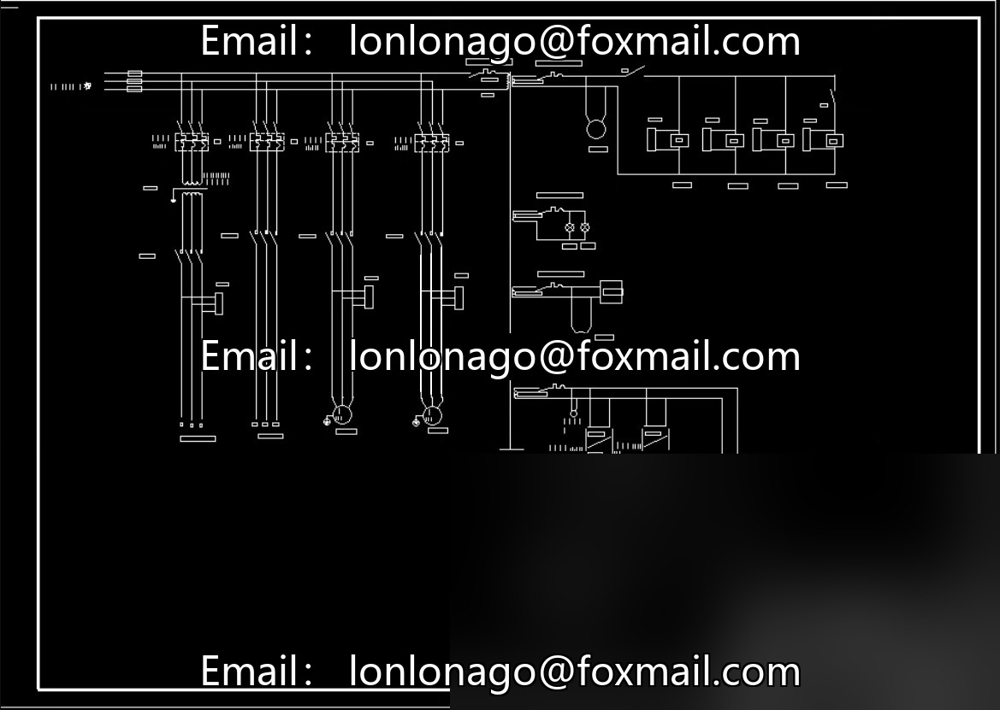
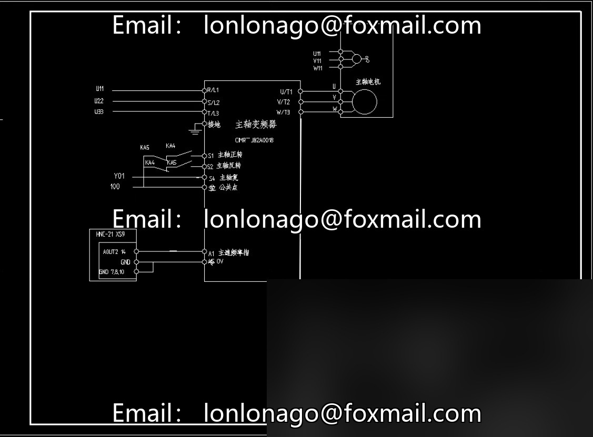
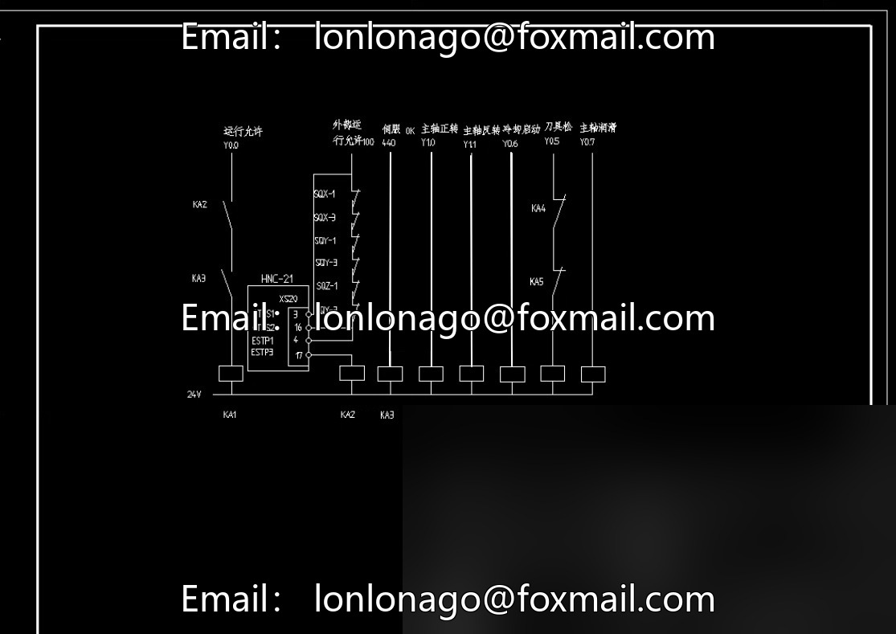
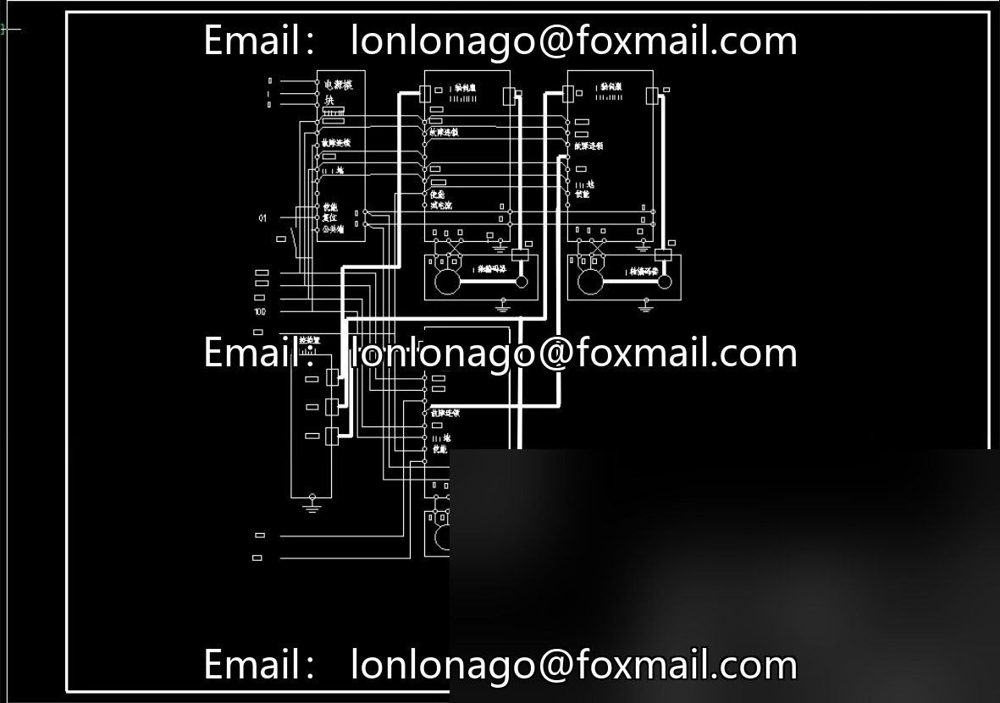
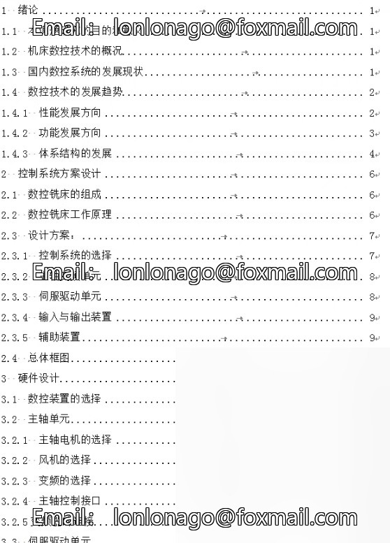
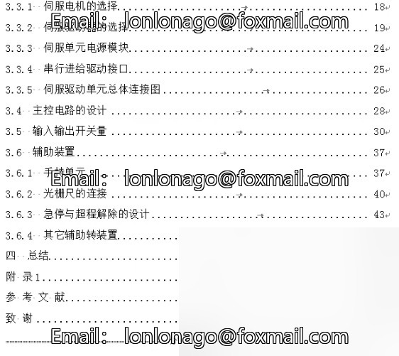

# CNC milling machine control system design CNC milling machine control system design drawing

## Body

CNC mill control system design
CNC mill control system design diagram
This design first describes the domestic and international development status of CNC technology and the development trends of CNC technology.
Subsequently, it conducts an in-depth exploration of the control system of the CNC mill, primarily understanding the overall layout, composition, and working principles of the CNC mill, as well as the control objects and controlled objects in the design of the CNC mill control system.
A overall plan is derived.
Then, the core CNC device of the CNC system is selected, and after comparison, the Huanhua CNC system is chosen for its control system, and then its components are designed block by block.
The spindle must achieve continuous speed change and forward/reverse operation within a certain range, so we select the spindle frequency converter based on the spindle motor model.

The CNC milling machine worktable must be able to move forward, to the left and right, and up and down on the X, Y, and Z axes, so servo drive units are used to control the motion of servo motors, thereby driving the motion of the worktable.
Next, design the main circuit of the control system. The main circuit involves the selection of air switches, contactors, arc extinguishing devices, lighting circuits, servo transformers, and control transformers.
Finally, design auxiliary devices for a CNC milling machine, including the holder unit of the CNC milling machine, the lighting circuit, the fan circuit, and the connection of the laser guide gauge.
396

The design includes a CNC milling machine control system design diagram, covering CNC technology development, control system design, module working principles and overall plans.

<!-- AI_ENRICHED -->

## Images

## Payment

Here is a pay link on Stripe ( https://buy.stripe.com/3cs8yP7sY87d0vu9AB ). Please contact me lonlonago@foxmail.com after funding $89, and I will send you a complete data files , thank you!

